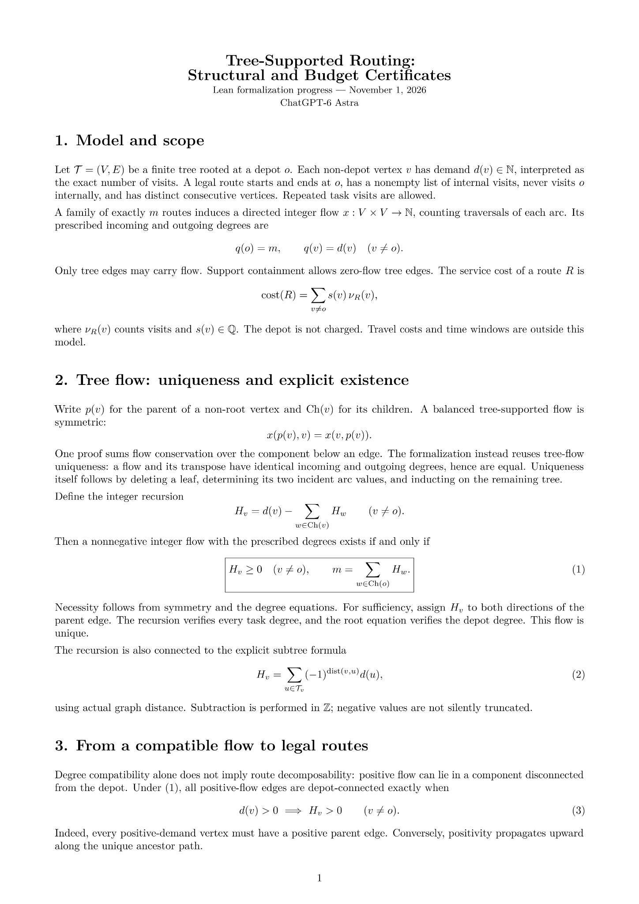
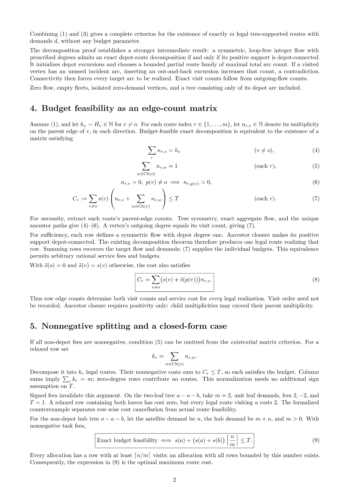
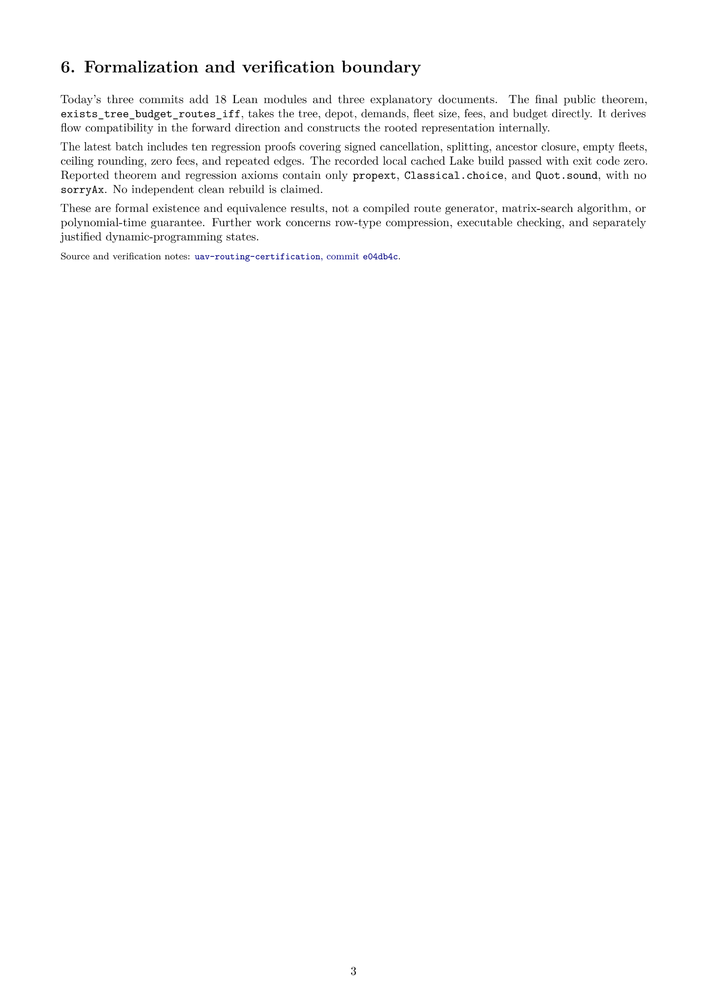

# UAV Routing Certification

**Lean 4 formalization of exact route decomposition, structural service constraints, and budget certificates.**

This research branch studies when an integer edge flow can be realized by legal depot routes with exact visit demands and individual service budgets. The current focus is tree-supported routing: explicit flow existence, exact decomposition, and a complete edge-count matrix characterization of budget feasibility.

**Research snapshot: November 6, 2026** · Branch: `research/structural-service-cuts-20261023`

The November 3 batch adds a verified full-state cache contract for [Issue #18](https://github.com/huam54925-cpu/uav-routing-certification/issues/18), a reachable-state separation example, and an exact encoding of rational service plus directional travel costs into the existing service-budget checker. The November 4 batch completes memoized recursion, certificate and root-branch integration, and reachable-state/cache-entry bounds; see [implementation and validation](docs/TREE_BUDGET_MEMO_SEARCH_STATUS.md). See [cache contract and validation](docs/TREE_BUDGET_MEMO_STATE_STATUS.md) and [cost encoding, state limits, and comparison with Xu, Döring, and Dias](docs/TREE_BUDGET_STATE_AND_LINEAR_COST_20261103.md).

The November 5 batches add general logical operation-count bounds, state-parameter bounds, array-backed vector operations, signed integer row checking, and bounds on every successful cache entry. [Issue #20](https://github.com/huam54925-cpu/uav-routing-certification/issues/20) is complete within its revised stage scope. Its remaining work is tracked separately in [#22: ordered representation refinement and bit costs](https://github.com/huam54925-cpu/uav-routing-certification/issues/22) and [#23: strict-hub hardness correspondence](https://github.com/huam54925-cpu/uav-routing-certification/issues/23). See the [current status and historical validation records](docs/TREE_BUDGET_OPERATION_BOUNDS_STATUS.md).

The November 6 packages complete ordered materialized candidate-list correspondence ([#22 package record](docs/TREE_BUDGET_VECTOR_CANDIDATES_STATUS.md)) and the first route/row representation bridges ([#21 package record](docs/TREE_BUDGET_REPRESENTATION_BRIDGE_STATUS.md)). The latter adds normalized reconstruction, signed tree-side certificate bridges, the shared-domain next equivalences, and explicit information-loss examples. The [English representation contract](docs/TREE_BUDGET_REPRESENTATION_CONTRACT.tex) explains the proved interfaces; the [allocation note](docs/TREE_BUDGET_ALLOCATION_BOUNDARIES.tex) supplies paper-only proofs for #23 and #19.

[Budget matrix results](docs/TREE_BUDGET_MATRIX.md) · [Tree existence and decomposition](docs/TREE_FLOW_EXISTENCE.md) · [Tree uniqueness and hub packing](docs/TREE_HUB_FORMALIZATION.md) · [Research roadmap](https://github.com/huam54925-cpu/uav-routing-certification/issues/15)

The small-scale measurement package now includes proved statistics erasure and controlled comparisons: [performance report and reproduction commands](docs/TREE_BUDGET_MEMO_PERFORMANCE.md). On these tiny cases, memoization reduces repeated expansions but association-list overhead makes cold search slower; pre-generated warm hits and full-entry repeated calls are measured separately.

## Current mathematical results

| Question | Formalized result |
| --- | --- |
| What determines a tree-supported flow? | Specified incoming and outgoing degrees determine at most one flow. An integer recursion gives an explicit existence criterion and an alternating subtree-sum formula. |
| When does a compatible tree flow admit legal depot routes? | Exactly when all positive-flow edges are connected to the depot; equivalently, every positive-demand non-root vertex has a positive parent-edge multiplicity. |
| What information determines a route's service cost? | Its parent-edge multiplicities determine every visit count and its service cost, independently of the chosen legal visit order. |
| When are individual budgets feasible on a tree? | Exactly when flow compatibility and a four-constraint edge-count matrix hold: column sums, one depot departure per row, ancestor closure, and row budgets. |
| Can the one-departure condition be relaxed? | For nonnegative non-depot fees, rows can be split and normalized without changing feasibility. A signed-fee counterexample shows why nonnegativity matters. |
| Is there a closed-form special case? | For a non-depot hub with one satellite, nonnegative task fees and a nonempty fleet, feasibility is determined by a ceiling-allocation formula. |
| Can service and travel budgets reuse the checker? | Rational directional edge costs have an exact signed virtual-service encoding, preserving route costs and matrix/certificate feasibility. |
| Can a few aggregate totals replace the residual vector? | Two states of the same input have the same route count, total cost, visit totals, and positive support, but opposite feasibility. This particular summary is insufficient. |
| What is proved for caching? | Complete memoized recursion preserves the fixed-input answer contract, returns a witness iff the residual problem is feasible, and integrates with the original checker and root-branch interfaces. Reachable-key and actual cache-entry bounds are proved; the executable key remains full `(k,r)`. |
| Do statistics describe the same search? | Erasing counters preserves the exact answer and cache of the memoized executor and the exact answer of the uncached executor. Controlled small-instance measurements are complete. General logical operation-count bounds are now proved; full bit-cost formalization remains open. |
| What bounds the cold search? | At the formal empty-cache entry, expansions and final cache entries are at most `S(H)`, candidate checks at most `S(H)^2`, and lookup-entry comparisons at most `S(H)+S(H)^3`. The general accounting identities and the restricted initial-state bounds have separate assumptions. |
| What is verified for explicit representations? | Array-vector operations, signed integer row checking, and exact ordered candidate-list correspondence are proved. A valid, duplicate-free cache with reachable keys has a bound for every successful stored answer. Full search/cache correspondence and bit-cost semantics remain open. |
| What does route-to-row projection preserve? | A normalized structural row has a realizing route whose projection recovers that row, preserving visits and arbitrary signed additive costs. Next-certificate equivalences are connected on their shared nonnegative-fee, positive-budget domain. Explicit examples distinguish loss of route order from loss of per-route budget information. |

Let `S(H) = ∏_{v≠o}(H(v)+1)`, `M = Σ_{v≠o}H(v)`, `t` be the number of positive nonroot coordinates, and `U` their maximum (zero if none). Lean proves `S(H) ≤ 2^M`, `S(H) ≤ (U+1)^t`, and the resulting logical-count and witness-length bounds.

The [bit-cost source note](docs/TREE_BUDGET_BIT_COST_NOTE.tex) gives a **paper-level** bound `O(S(H)^3 (M+1) (ell+1)^5)` for a specified binary-input, explicit-vector implementation, with FPT consequences for `M` and `(t,U)`. Here `ell` is the encoded input length. This is not yet a Lean time theorem or a runtime guarantee for the compiled Lean program. The task starts from `H` and outputs a decision or explicit row matrix; demand wrappers, physical-route expansion, root-branch wrappers, and compressed output are outside that time claim.

The [PDF uploaded on November 5](docs/budget%20%281%29.pdf) is an earlier snapshot of this note. It omits the later source additions on verified representation components and the duplicate-free/reachable-cache justification for bounds on all stored successful answers. Use the current `.tex` and status record for those updates; the PDF has not been regenerated in this documentation update.

The public theorem [`exists_tree_budget_routes_iff`](LeanCompletion/UAV/TreeBudgetCriterion.lean) accepts a finite tree, depot, demands, fleet size, service fees, and budget. It derives flow compatibility in the forward direction and constructs the rooted representation internally. No preselected route ordering or additional unproved rooted-tree data is required.

### Model

Routes start and end at the depot, have a nonempty internal visit list, never visit the depot internally, and have distinct consecutive vertices. Repeated task visits are allowed and each incurs its service fee. Demands count visits exactly; the depot's demand and service fee are ignored. Support means containment, so some tree edges may carry zero flow.

The tree matrix equivalence allows arbitrary rational service fees and budgets. Splitting normalization assumes nonnegative fees only at non-depot vertices. The new cost bridge covers additive rational service and directional travel costs on tree edges. Its virtual fees may be negative even for nonnegative physical costs, so nonnegative-service pruning needs separate justification. Time windows, waiting, order-dependent costs, and exact irrational distances remain outside this bridge.

## Illustrated mathematical overview

The three historical November 1 pages below explain the definitions, proof ideas, matrix constraints, normalization, and that batch's verification boundary. Later executable search and cost/cache results are described in the linked status documents above. Click a page to open the full-resolution image.

[](docs/images/tree-routing-20261101/page-01.png)

[](docs/images/tree-routing-20261101/page-02.png)

[](docs/images/tree-routing-20261101/page-03.png)

## Proof and source map

| Layer | Lean source | Explanation |
| --- | --- | --- |
| Tree-flow uniqueness and support/exact equivalence | [TreeSupportExact](LeanCompletion/UAV/TreeSupportExact.lean) | [Tree and hub baseline](docs/TREE_HUB_FORMALIZATION.md) |
| Integer recursion and flow existence | [TreeFlowExistence](LeanCompletion/UAV/TreeFlowExistence.lean), [TreeFlowAlternating](LeanCompletion/UAV/TreeFlowAlternating.lean) | [Tree existence](docs/TREE_FLOW_EXISTENCE.md) |
| Connectivity and budget-free decomposition | [TreeFlowConnectivity](LeanCompletion/UAV/TreeFlowConnectivity.lean), [TreeRouteDecomposition](LeanCompletion/UAV/TreeRouteDecomposition.lean), [TreeFlowCriterion](LeanCompletion/UAV/TreeFlowCriterion.lean) | [Decomposition and boundary cases](docs/TREE_FLOW_EXISTENCE.md) |
| Row realization, visit counts, and linear cost | [TreeBudgetRow](LeanCompletion/UAV/TreeBudgetRow.lean) | [Single rows and cost sufficiency](docs/TREE_BUDGET_MATRIX.md#single-rows-and-cost-sufficiency) |
| Budget matrix iff and direct tree entry point | [TreeBudgetMatrix](LeanCompletion/UAV/TreeBudgetMatrix.lean), [TreeBudgetCriterion](LeanCompletion/UAV/TreeBudgetCriterion.lean) | [Four-constraint theorem](docs/TREE_BUDGET_MATRIX.md#four-constraint-theorem) |
| Nonnegative splitting normalization | [TreeBudgetNormalization](LeanCompletion/UAV/TreeBudgetNormalization.lean) | [Splitting](docs/TREE_BUDGET_MATRIX.md#nonnegative-splitting-normalization) |
| Hub packing and the single-satellite formula | [HubSpokePacking](LeanCompletion/UAV/HubSpokePacking.lean), [SingleSatelliteClosed](LeanCompletion/UAV/SingleSatelliteClosed.lean) | [Single satellite](docs/TREE_BUDGET_MATRIX.md#single-satellite) |
| Boundary and regression proofs | [TreeFlowExamples](LeanCompletion/UAV/TreeFlowExamples.lean), [TreeBudgetExamples](LeanCompletion/UAV/TreeBudgetExamples.lean) | Nine tree-flow checks and ten budget regression proofs |
| Residual cache contract and regression proofs | [TreeBudgetMemoState](LeanCompletion/UAV/TreeBudgetMemoState.lean), [TreeBudgetMemoStateExamples](LeanCompletion/UAV/TreeBudgetMemoStateExamples.lean) | [Issue #18 first package](docs/TREE_BUDGET_MEMO_STATE_STATUS.md) |
| Complete memoized search, interfaces, and state bounds | [TreeBudgetMemoSearch](LeanCompletion/UAV/TreeBudgetMemoSearch.lean), [TreeBudgetMemoIntegration](LeanCompletion/UAV/TreeBudgetMemoIntegration.lean), [TreeBudgetMemoReachability](LeanCompletion/UAV/TreeBudgetMemoReachability.lean), [TreeBudgetMemoBounds](LeanCompletion/UAV/TreeBudgetMemoBounds.lean), [TreeBudgetMemoExamples](LeanCompletion/UAV/TreeBudgetMemoExamples.lean) | [Recursion and validation](docs/TREE_BUDGET_MEMO_SEARCH_STATUS.md) |
| Verified statistics and controlled measurements | [TreeBudgetSearchStats](LeanCompletion/UAV/TreeBudgetSearchStats.lean), [TreeBudgetBenchCases](LeanCompletion/UAV/TreeBudgetBenchCases.lean), [TreeBudgetBench](LeanCompletion/UAV/TreeBudgetBench.lean), [bounded runner](LeanCompletion/UAV/run_tree_budget_bench.py) | [Performance report and reproduction](docs/TREE_BUDGET_MEMO_PERFORMANCE.md) |
| Logical operation counts and parameters | [TreeBudgetSearchStatsBounds](LeanCompletion/UAV/TreeBudgetSearchStatsBounds.lean), [TreeBudgetCandidateCount](LeanCompletion/UAV/TreeBudgetCandidateCount.lean), [TreeBudgetSearchCostBounds](LeanCompletion/UAV/TreeBudgetSearchCostBounds.lean), [TreeBudgetStateParameters](LeanCompletion/UAV/TreeBudgetStateParameters.lean), [TreeBudgetParameterizedBounds](LeanCompletion/UAV/TreeBudgetParameterizedBounds.lean) | [Stage records and follow-up scope](docs/TREE_BUDGET_OPERATION_BOUNDS_STATUS.md) |
| Explicit vector and integer row-check components | [TreeBudgetVector](LeanCompletion/UAV/TreeBudgetVector.lean), [TreeBudgetIntegerCost](LeanCompletion/UAV/TreeBudgetIntegerCost.lean), [TreeBudgetVectorChecker](LeanCompletion/UAV/TreeBudgetVectorChecker.lean) | [Representation package and validation](docs/TREE_BUDGET_OPERATION_BOUNDS_STATUS.md) |
| Ordered materialized candidate generation | [TreeBudgetVectorCandidates](LeanCompletion/UAV/TreeBudgetVectorCandidates.lean), [examples](LeanCompletion/UAV/TreeBudgetVectorCandidatesExamples.lean) | [Candidate-package validation](docs/TREE_BUDGET_VECTOR_CANDIDATES_STATUS.md) |
| Route/row reconstruction and certificate bridges | [TreeBudgetRepresentationBridge](LeanCompletion/UAV/TreeBudgetRepresentationBridge.lean), [examples](LeanCompletion/UAV/TreeBudgetRepresentationBridgeExamples.lean) | [First-package validation](docs/TREE_BUDGET_REPRESENTATION_BRIDGE_STATUS.md), [English mathematical source](docs/TREE_BUDGET_REPRESENTATION_CONTRACT.tex) |
| Bounds on stored successful answers | [TreeBudgetCacheEntryBounds](LeanCompletion/UAV/TreeBudgetCacheEntryBounds.lean), [regressions](LeanCompletion/UAV/TreeBudgetCacheEntryBoundsExamples.lean) | [CacheReady and duplicate-key boundary](docs/TREE_BUDGET_OPERATION_BOUNDS_STATUS.md) |
| State separation and travel-cost encoding | [TreeBudgetStateSeparationExamples](LeanCompletion/UAV/TreeBudgetStateSeparationExamples.lean), [TreeBudgetLinearCost](LeanCompletion/UAV/TreeBudgetLinearCost.lean), [TreeBudgetLinearCostExamples](LeanCompletion/UAV/TreeBudgetLinearCostExamples.lean) | [Results and literature comparison](docs/TREE_BUDGET_STATE_AND_LINEAR_COST_20261103.md) |

The decomposition layer also proves a more general result for **symmetric, loop-free integer flows**: with prescribed degrees, depot connectivity of positive flow is equivalent to exact budget-free decomposition. Its proof uses a bounded maximal partial route family and an excursion-insertion argument.

## Verification status

Historical November 3 record: the new cache contract and examples are checked in the existing local development project; the [cache status](docs/TREE_BUDGET_MEMO_STATE_STATUS.md) records commands, axiom reports, and publication-source comparison. The accompanying [cost/state report](docs/TREE_BUDGET_STATE_AND_LINEAR_COST_20261103.md) retains its separate validation record. That batch used local cached checks and did not yet run a complete memoized solver; the subsequent recursion and measurement batches below have their own records.

The November 1 proof batches add **18 Lean modules and three explanatory documents**:

- [`101fddd`](https://github.com/huam54925-cpu/uav-routing-certification/commit/101fddd7a947f751afd6fb060de08978ad4c82a6): tree-flow uniqueness and strict-hub packing.
- [`674120e`](https://github.com/huam54925-cpu/uav-routing-certification/commit/674120ef954dbddef40acbf315f8b461e2b24fe0): tree-flow existence, connectivity, insertion, decomposition, and alternating sums.
- [`e04db4c`](https://github.com/huam54925-cpu/uav-routing-certification/commit/e04db4c37376e65d252553e241f23f2d1b74453b): tree budget matrices, splitting normalization, and the single-satellite formula.

**November 1 recorded validation: local cached builds passed in the original development project. No independent clean rebuild or standalone publication-package rebuild is claimed.** That batch records exit code 0 and main-theorem/regression axiom reports containing only `propext`, `Classical.choice`, and `Quot.sound`, with no `sorryAx`. Non-fatal linter warnings remain. Editing this README does not constitute a new Lean build or axiom audit.

Toolchain: Lean `4.30.0-rc2`, with dependency revisions pinned in [lake-manifest.json](lake-manifest.json). Targeted commands from the project root:

```powershell
lake build LeanCompletion.UAV.TreeFlowCriterion LeanCompletion.UAV.TreeFlowExamples
lake build LeanCompletion.UAV.TreeBudgetExamples
lake build LeanCompletion.UAV.TreeBudgetMemoStateExamples LeanCompletion.UAV.TreeBudgetLinearCostExamples
lake build LeanCompletion.UAV.TreeBudgetMemoExamples LeanCompletion.UAV.TreeBudgetMemoBounds
lake build LeanCompletion.UAV.TreeBudgetBenchCases LeanCompletion.UAV.TreeBudgetBench
```

The earlier November 1 batch supplied existence and equivalence theorems. Subsequent modules provide complete finite and uncached residual search, root-branch integration, and stable certificate compression. The November 4 recursion batch (`c4f9dfe`) records five new modules, 30 kernel regressions, and 89 theorem axiom reports; the 30 regressions are included in the 89 theorems.

The subsequent [measurement batch (`612b075`)](https://github.com/huam54925-cpu/uav-routing-certification/commit/612b07505ce9a4850a11400b128d69751cf88c39) completes Issue #18's agreed small-scale package. Its separate local validation records three new Lean modules and 19 theorem axiom reports (9 statistics-erasure theorems plus 10 case theorems), with no `sorryAx`. The controlled run used 65 timing phases and 1,365 recorded timing samples; the process took 51.94 seconds including startup/loading, not the whole development or build effort. In the two shared-state examples, cold memoization reduced expansions by 33.3% and 40.7%, but search-only median times were 3.59 and 3.06 times the uncached times. Pre-generated warm hits and full-entry repeated calls were measured separately. These are observations for the documented tiny inputs and execution environment, not a general speedup claim.

The November 5 proof batches subsequently added general operation counts and parameter bounds (`1f4774c`, `cafae97`). The representation package [`5114dc8`](https://github.com/huam54925-cpu/uav-routing-certification/commit/5114dc8efc5b5082aefd4640b403285d129db2b2) records four main modules and two regression modules, with 27 main theorems and 8 regression theorems passing the existing local build and axiom-audit procedure. The [stage record](docs/TREE_BUDGET_OPERATION_BOUNDS_STATUS.md) distinguishes each successful build, cache reuse, and the actual verification scope.

The November 6 candidate package records 9 main and 8 regression theorems. The subsequent representation-bridge package records 15 main and 12 regression theorems, all checked in the existing local environment with standard axiom dependencies and no `sorryAx`; see its [actual commands, warnings, and evidence boundaries](docs/TREE_BUDGET_REPRESENTATION_BRIDGE_STATUS.md). Neither publication repeats the earlier performance experiments or claims a clean rebuild. Raw samples, logs, and build products remain local. Full ordered-search refinement and bit-cost formalization remain in [#22](https://github.com/huam54925-cpu/uav-routing-certification/issues/22). That package supplied paper proofs of the #23 semantic construction and #19 gluing example; the later Lean semantic package is recorded below. Initial publication did not compile their LaTeX sources. Separately supplied PDFs were later reviewed; the representation source now splits an overflowing equivalence chain, but that correction has not been recompiled. See the [separate PDF review and follow-up scope](docs/TREE_BUDGET_REPRESENTATION_BRIDGE_STATUS.md).

The November 7 [strict-hub three-partition semantic package](docs/HUB_THREE_PARTITION_STATUS.md) adds three Lean modules with 33 theorem declarations, including 16 regressions. All three targeted builds succeeded in the existing development environment; a separate audit covered all 44 new declarations with no `sorryAx`. It proves the canonical strict-hub exact-feasibility iff under the stated source assumptions, including the empty-fleet case. This completes the bounded semantic task in #23; binary encoding, reduction cost, and complexity classifications remain separate. The [single-excursion contract](docs/TREE_BUDGET_SINGLE_EXCURSION_CONTRACT.tex) supplies #19's restricted paper specification and finite checks, not new Lean results or a general subtree DP. Publication reuses those checks and is not a fresh rebuild.

The subsequent [binary-encoding note](docs/HUB_THREE_PARTITION_ENCODING.tex) fixes a self-delimiting source format and an explicit sparse tree target. It gives paper proofs of the exact output length, the valid-input bound `4L+3`, a total polynomial-time reduction, and polynomial certificates for the canonical strict-hub sublanguage. Using the explicitly cited classical 3-PARTITION theorem, it derives strong NP-completeness for that sublanguage and strong NP-hardness for the general tree problem. General NP membership is not established. Its finite Python checks and direct source review are recorded separately from Lean validation; the encoding and complexity results are not new kernel-checked theorems, and the LaTeX source has not been compiled.

## Earlier general certificate framework

The tree results build on the broader study of repeated visits and exact resource-constrained decomposition:

- Visit-copy lifting and exact decomposition: [decomposition status](docs/COPY_PROFILE_DECOMPOSITION_STATUS.md).
- Profile cuts, fixed-lift enumeration, and violation reports: [cuts](docs/COPY_PROFILE_CUTS_STATUS.md), [checker](docs/COPY_PROFILE_CHECKER_STATUS.md), [reports](docs/COPY_PROFILE_REPORT_STATUS.md).
- Local pairing, ranks, and service potentials: [completeness](docs/LOCAL_VISIT_PAIRING_COMPLETENESS_STATUS.md).
- Next-only and bounded certificates: [bounded certificate status](docs/BOUNDED_NEXT_CERTIFICATE_STATUS.md).
- Finite candidates, a single-candidate checker, and representation bounds: [finite certificate status](docs/FINITE_CERTIFICATE_STATUS.md), [input-size module](LeanCompletion/UAV/LocalVisitPairingInputSize.lean).

Each stage retains its own verification record. The general certificate checker and fixed-lift profile checker should not be confused with a tree-matrix search algorithm.

## Next research directions

The near-term sequence prioritizes a reusable model and trustworthy interfaces. Existing complete search is a verified reference implementation; ordinary enumeration, memoization, pattern aggregation, and tree DP are established techniques, and no algorithmic novelty is asserted.

The first #21 bridge package, first #22 candidate-list package, and #23 strict-hub semantic package are complete within their stated scopes; the broader issues remain open. The #23 binary-encoding and restricted complexity argument is now available as a paper proof. Keep #19 at its completed restricted paper specification.

1. **Formalize the encoding layer for [#23](https://github.com/huam54925-cpu/uav-routing-certification/issues/23).** The [semantic package](docs/HUB_THREE_PARTITION_STATUS.md) supplies the verified exact-routing iff; the [encoding note](docs/HUB_THREE_PARTITION_ENCODING.tex) now fixes the binary formats, proves size and construction bounds on paper, and gives the restricted complexity conclusions with their external source. Decoder round trips, the exact length formula and a machine-cost model remain candidates for Lean formalization. General binary-input NP membership requires a separate certificate-size argument.
2. **Hold [#19](https://github.com/huam54925-cpu/uav-routing-certification/issues/19) at its restricted paper specification.** The [single-excursion contract](docs/TREE_BUDGET_SINGLE_EXCURSION_CONTRACT.tex) fixes ownership, paired crossings, exact accounting, matrix realizability, and contextual replacement, with bounded Python checks. Lean implementation, multiple excursions, and a general inductive interface remain later tasks.
3. **Retain the later representation tasks in [#21](https://github.com/huam54925-cpu/uav-routing-certification/issues/21).** The first package preserves signed tree-side interfaces and the narrower reverse next assumptions. Full certificate round trips, indexing conventions, executable reconstruction, and representation-size comparisons remain future packages, chosen when a concrete consumer requires them.
4. **Keep [#22](https://github.com/huam54925-cpu/uav-routing-certification/issues/22) as an independent implementation follow-up.** Exact candidate-list order and multiplicity are proved. Ordered search/cache simulation and logical-event correspondence come before a full bit-cost semantics; they are not prerequisites for #23's semantic proof.

For #22, exact candidate order is needed to inherit the current executor's concrete answers, ordered caches, and event counts. Future algorithms may instead target the weaker mathematical contract of feasibility and valid certificates. Completion of the entire bit-cost formalization is not a prerequisite for #21 or the semantic part of #23.

Encoding matters: a matrix with `m(|V| - 1)` natural-number entries is not automatically polynomial-size in a binary-encoded fleet size. The paper upper bounds do not establish general polynomial time, XP in `t` alone for binary input, or optimality of the current search. See [Issue #15](https://github.com/huam54925-cpu/uav-routing-certification/issues/15) for the wider roadmap and the [literature comparison](docs/TREE_BUDGET_LITERATURE_REVIEW_20261103.md) for model distinctions. Further performance experiments should answer a specific new question; #18's agreed package is complete.

## Historical application and repository materials

<details>
<summary>Original UAV benchmark, Case1 baseline, papers, and archived programs</summary>

The project originated in a multi-UAV inspection benchmark. The original paper, the repeated-visit correction, the formal lower-bound proof, and the independently checked feasible witness are separate evidence layers. They remain available as historical material; current research concentrates on general route-decomposition theory.

For the fixed historical Case1 model, the lower bound is formalized in Lean and the four-UAV witness was checked by a separate Python verifier. The combined minimum-fleet conclusion is mixed verification, not a Lean theorem of four-UAV feasibility or globally optimal completion time. Its scope and historical validation are documented below.

| Material | Location |
| --- | --- |
| Original paper, appendices, and figures | [paper/original](paper/original/README.md) |
| Repeated-visit correction | [paper/revised](paper/revised/README.md) |
| Historical Case1 proof and model boundary | [Kernel closure record](docs/CASE1_KERNEL_CLOSURE_STATUS.md), [model correspondence](docs/MODEL_CORRESPONDENCE.md) |
| Problem statements and input tables | [source_materials/problem_A](source_materials/problem_A/README.md) |
| Question 1–3 programs and published attachments | [submission_package](submission_package/README.md) |
| ALNS research and selected certificates | [research](research/README.md) |
| Historical Lean module index | [LeanCompletion/UAV](LeanCompletion/UAV/README.md) |
| Provenance and reproduction notes | [Sources](docs/SOURCES.md), [reproducibility](docs/REPRODUCIBILITY.md), [timeline](docs/RESEARCH_TIMELINE.md) |

Historical PASS records refer to their original environments and dates. They are not new validation runs performed by this branch-homepage update.

</details>

## License and attribution

The repository retains its [Apache-2.0 license](LICENSE). Problem statements and third-party materials retain their original sources and attribution; provenance notes do not relicense those materials.
