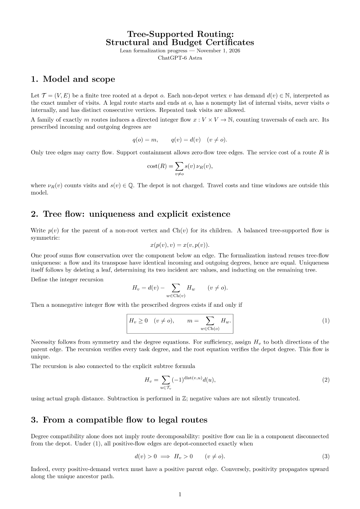
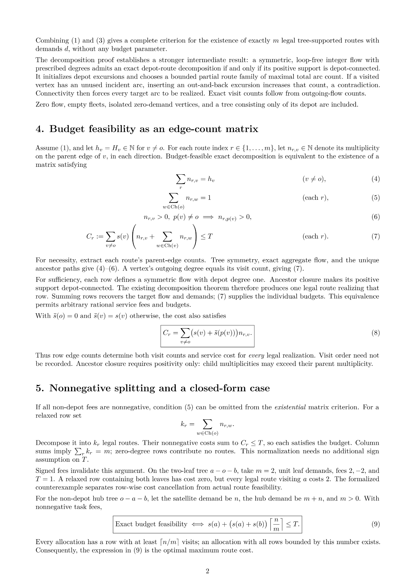
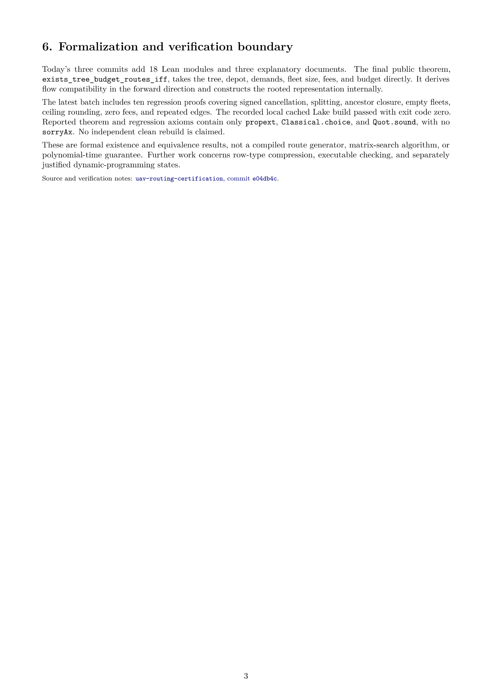

# UAV Routing Certification

**Lean 4 formalization of exact route decomposition, individual budgets, executable certificates, and stated cost models.**

This research branch studies when an integer edge flow can be realized by legal depot routes with exact visit demands and individual service budgets. The current focus is tree-supported routing: explicit flow existence, exact decomposition, and a complete edge-count matrix characterization of budget feasibility.

**Research snapshot: November 18, 2026** · Branch: `research/structural-service-cuts-20261023`

The November 18 proofs compute the least feasible tree budget, reuse one table across rational budget queries, certify the persistent heap growth of deduplication, and expand checked certificates into legal vertex routes. The module interfaces, cost boundaries and reproduction commands are in [Subtree budgets, deduplication and explicit routes](docs/TREE_BUDGET_PROFILES_HEAP_AND_ROUTES.md).

## Current research and the next three packages

[Current results and claim boundaries](docs/TREE_ROUTING_RESEARCH_STATUS_20261118.md) · [November 18 literature review](docs/TREE_BUDGET_LITERATURE_REVIEW_20261118.md) · [Detailed next-step plan](docs/TREE_BUDGET_INNOVATION_ROADMAP_20261118.md) · [Chinese research draft — LaTeX source](docs/TREE_ROUTING_RESEARCH_DRAFT_20261118_ZH.tex)

The next research phase studies **sparse solution certificates, information needed for subtree completion, and route-permutation algorithms** within the existing exact-flow tree model. Package A has priority: [A0–A2 structure](docs/TREE_BUDGET_SPARSE_CERTIFICATES_STATUS.md), [A3 binary verification and actual witness length](docs/TREE_BUDGET_SPARSE_WIRE_STATUS.md), [A4 parsing and column costs](docs/TREE_BUDGET_SPARSE_BITCOST_STATUS.md), and now [complete reference-word verifier work and a first concrete TM2 component](docs/TREE_BUDGET_SPARSE_TOTAL_WORK_STATUS.md). The full verifier's standard-machine simulation and unconditional NP membership remain pending; B and C remain plans.

| Package | Intended result | Status and scope |
| --- | --- | --- |
| [A: sparse certificates — #24](https://github.com/huam54925-cpu/uav-routing-certification/issues/24) | Simultaneous support bounds, quadratic actual witness length, complete verifier refinement and `4194304*(L+W+1)^6` reference-word work on every input pair | A0–A4 first batch published through `981a07c`; [total-work follow-up](docs/TREE_BUDGET_SPARSE_TOTAL_WORK_STATUS.md) also constructs a linear-time TM2 framing recognizer. The complete verifier machine and unconditional NP membership remain pending |
| [B: completion interfaces — #25](https://github.com/huam54925-cpu/uav-routing-certification/issues/25) | A five-vertex family with many context-distinguishable states, including a route-permutation version | Paper derivation available; a supplied-completion/representative-family lower bound, not a lower bound for all algorithms; linked to #19/#21 |
| [C: route-permutation DP — #26](https://github.com/huam54925-cpu/uav-routing-certification/issues/26) | Joint-type histograms, exact transport-table matching, witness recovery, and state/coupling bounds | Planned new executor; preserves feasibility/optimum and checked witnesses, without assuming the old tie-breaking matrix is unchanged; linked to #19 |

The literature review attributes integer-cone, representative-set and multiset-DP methods to their sources. The new 2026 integer-cone FPT results are external preprints, not the repository's machine-checked algorithm. Existing #22 final acceptance and #19 whole-executor cost closure remain separate tasks. The original `3389ea7` documentation/source-draft update ran no Lean build, axiom audit, benchmark or LaTeX compilation; subsequent A-package validation is recorded separately.

<details>
<summary>Earlier package summaries and their dated verification records</summary>

The November 15 [resource package G0–G4](docs/TREE_BUDGET_SUBTREE_RESOURCES_STATUS.md) extends the automatic integer witness executor with an early root-mass guard, reduced-denominator identities, intermediate integer magnitude bounds, exact matrix construction charges and complete 17-field statistics transport. The single-run measured solver preserves the full certificate and satisfies `resourceWork ≤ 64*(N+1)^2*(m+1)*(U+1)*P^2`, with a guarded total-mass corollary. The model excludes preprocessing, counter maintenance and machine/heap overhead. The supplied [Chinese paper reference](docs/SUBTREE_RESOURCE_PROOFS_ZH.tex) is preserved without LaTeX compilation; verification and reproduction details are in the package record.

The November 17 [preprocessing package H0–H4](docs/TREE_BUDGET_SUBTREE_PREPROCESSING_STATUS.md) adds materialized input, a counted root guard, one-run LCM/scaling/floor preparation, complete certificate and statistics refinement, intermediate-width and Euclid bounds, and a degree-six polynomial in an explicit padded arithmetic charging model. Its counters are ghost observations; its bit charge is not Lean runtime or a complete DP machine-time theorem. The rejection cost depends on the binary width of the route count, including `m=2^200`, before any route-dimensional vector is built. [#19](https://github.com/huam54925-cpu/uav-routing-certification/issues/19) retains the whole-DP machine-cost work; explicit tree route output was subsequently delivered on November 18, with its own remaining time-analysis scope.

The November 17 [uniform scalar package I0–I4](docs/TREE_BUDGET_SUBTREE_SCALAR_STATUS.md) charges the complete single-run subtree DP, including all-number child scans, full tail-key maps, coordinate comparisons, matrix reads/additions and list control. It preserves the entire selected certificate and all 17+9 observations, proves `C_DP ≤ 4096*(N+1)*(m+1)^2*(1+resourceWork)`, and combines H and I at one common padded width. At the I-package boundary, object representation, addresses, allocation, sharing and control frames were separate. November 18 adds a local addressed deduplication refinement; whole-DP closure is still open and #22's theorem is not inherited. The proof source is [66bcf08](https://github.com/huam54925-cpu/uav-routing-certification/commit/66bcf082189e3b368693af93a5008a213e7ddaba). Its common width conservatively includes the DP operation upper bound itself, rather than its logarithm; this completes the stated scalar model without claiming a tight input-bit exponent. The package record reports 13 built modules, 205 audited declarations, 608 full-record regressions and 1,225 comparison cases. This navigation update does not rerun them.

The November 15 [automatic integer certificate package F0–F4](docs/TREE_BUDGET_SUBTREE_AUTO_STATUS.md) completes LCM preprocessing and integer witness search. `solveAuto_eq` proves equality of the entire returned certificate with the rational witness solver, preserving ordered payloads and rightmost representatives. It inherits checker soundness, failure completeness, certificate size and the route bridge with `HasDegrees`. Validation in the existing development environment passed 603 new executable regressions, 11 kernel examples, a 63-declaration axiom audit without `sorryAx`, and the affected 483 + 21 earlier regressions. The independent Python model also passed 66,240 certificate comparisons. Publication preserves the validated source; it is not a cold build or a new timing experiment.

The November 14 [subtree bounds, integer refinement and certificate package](docs/TREE_BUDGET_SUBTREE_BOUNDS_STATUS.md) proves signed grid and composition bounds, bounds all 17 existing execution statistics, preserves ordered tables and counts under integer scaling, and constructs certificates accepted by the original checker. Its validation record includes zero-route and empty-table regressions, a full new-declaration axiom audit, and separate integer timing measurements. These are logical operation bounds, not a machine-time or peak-memory bound for the subtree executor.

The November 13 [literature review and exact-subtree algorithm plan](docs/TREE_INTERFACE_ALGORITHM_RESEARCH_20261113.md) revisited #19 as an algorithm-design direction. It added primary-source links, model distinctions, and a proposed labeled boundary-multiplicity/cost-state recurrence based on the existing matrix theorem. That document records the paper-design stage; use the implementation records through the November 18 budget/query, deduplication and route-output modules for current proof status. #23 reduction/verification machine costs remain an independent follow-up, not a prerequisite for this research.

The November 3 batch adds a verified full-state cache contract for [Issue #18](https://github.com/huam54925-cpu/uav-routing-certification/issues/18), a reachable-state separation example, and an exact encoding of rational service plus directional travel costs into the existing service-budget checker. The November 4 batch completes memoized recursion, certificate and root-branch integration, and reachable-state/cache-entry bounds; see [implementation and validation](docs/TREE_BUDGET_MEMO_SEARCH_STATUS.md). See [cache contract and validation](docs/TREE_BUDGET_MEMO_STATE_STATUS.md) and [cost encoding, state limits, and comparison with Xu, Döring, and Dias](docs/TREE_BUDGET_STATE_AND_LINEAR_COST_20261103.md).

The November 5 batches add general logical operation-count bounds, state-parameter bounds, array-backed vector operations, signed integer row checking, and bounds on every successful cache entry. [Issue #20](https://github.com/huam54925-cpu/uav-routing-certification/issues/20) is complete within its revised stage scope. The work split from that stage is tracked in [#22: ordered representation refinement and bit costs](https://github.com/huam54925-cpu/uav-routing-certification/issues/22) and [#23: strict-hub hardness correspondence](https://github.com/huam54925-cpu/uav-routing-certification/issues/23). See the [current status and historical validation records](docs/TREE_BUDGET_OPERATION_BOUNDS_STATUS.md).

The November 6 packages complete ordered materialized candidate-list correspondence ([#22 package record](docs/TREE_BUDGET_VECTOR_CANDIDATES_STATUS.md)) and the first route/row representation bridges ([#21 package record](docs/TREE_BUDGET_REPRESENTATION_BRIDGE_STATUS.md)). The latter adds normalized reconstruction, signed tree-side certificate bridges, the shared-domain next equivalences, and explicit information-loss examples. The [English representation contract](docs/TREE_BUDGET_REPRESENTATION_CONTRACT.tex) explains the proved interfaces; the [allocation note](docs/TREE_BUDGET_ALLOCATION_BOUNDARIES.tex) records the original paper proofs for #23 and #19. The #23 semantic correspondence was subsequently formalized in `dcc3db8`; the #19 counterexample and gluing contracts remain paper results.

The November 7 [interface follow-up](docs/HUB_INTERFACES_STATUS.md) adds executable assignment-certificate checking (including raw natural-number lists) and explicit numbered-target correspondence in Lean. Its separate [A/B paper](docs/TREE_SINGLE_EXCURSION_GENERALIZATION.tex) extends supplied-witness gluing to arbitrary internal subtrees behind one cut edge and proves the unrestricted sorted-budget matching criterion. [Public finite-check entry points](docs/REPRODUCING_BOUNDED_CHECKS.md) now accompany the papers. These layers have separate validation records. The #23 codec and length layer was completed in the November 9 package below; the #22 tree-budget execution codec is a distinct package.

The November 9 [strict-hub reduction encoding package](docs/HUB_REDUCTION_ENCODING_STATUS.md) completes the fourth work block: MSB gamma coding of `n+1`, source and sparse-target EOF parsing, canonical round trips and tail rejection, the sparse-record/numbered-model semantic bridge, the exact length formula, and the valid-input `4L+3` bound. It also proves a total bitstring transformation with the fixed 129-bit NO output, language equivalence, and `4|x|+129`. Machine construction/verification costs remain separate. The package contains 85 named theorems, including 19 regressions, and an exhaustive 303-declaration axiom audit.

The November 7 [complete vector-search refinement](docs/TREE_BUDGET_VECTOR_MEMO_REFINEMENT_STATUS.md) preserves concrete answers, ordered caches, and all six logical event counters. It connects the independent array-vector executor to the existing certificate interface, cache-member invariants, and logical bounds, including signed and unreduced-fraction inputs. This completes the search-refinement block of #22.

The subsequent [binary-cost package](docs/TREE_BUDGET_BINARY_COST_STATUS.md) supplies canonical binary parsing, checked parent arrays, actual bit arithmetic, complete costed execution through explicit matrix serialization, and the intrinsic-work bound `8,388,608 S^3 (ell+1)^4` for successfully parsed and validated inputs. Concrete typed storage and addressed block operations are also proved. That package alone did not establish the full evaluator-to-heap refinement.

The November 8 [shared-store execution package A–E](docs/TREE_BUDGET_STORED_EXECUTION_STATUS.md) completes that connection: shared answers, charged ordered caches, concrete search, the full input/output refinement, and the new executor's own cumulative allocation and total-cost bounds. Its addressed bit-cost model proves `steps + allocations <= 2^50 S^3 (ell+1)^7`, with FPT bounds for `M` and `(t,U)` covering every input string. This is not a compiled-Lean wall-clock or independent Turing-machine simulation claim. The [cost-model and literature comparison](docs/TREE_BUDGET_COST_MODEL_COMPARISON.md) is also available. #22 remains open for final acceptance review; A–E are no longer pending implementation. Source publication is [5953439](https://github.com/huam54925-cpu/uav-routing-certification/commit/595343965a91882e7894a9203a295d72009a71e0); [dda05c8](https://github.com/huam54925-cpu/uav-routing-certification/commit/dda05c86af22f9d8fa10590cf2c9c3bcf43a5d93) records migration to this existing research branch.

[Budget matrix results](docs/TREE_BUDGET_MATRIX.md) · [Tree existence and decomposition](docs/TREE_FLOW_EXISTENCE.md) · [Tree uniqueness and hub packing](docs/TREE_HUB_FORMALIZATION.md) · [Research roadmap](https://github.com/huam54925-cpu/uav-routing-certification/issues/15)

The small-scale measurement package now includes proved statistics erasure and controlled comparisons: [performance report and reproduction commands](docs/TREE_BUDGET_MEMO_PERFORMANCE.md). On these tiny cases, memoization reduces repeated expansions but association-list overhead makes cold search slower; pre-generated warm hits and full-entry repeated calls are measured separately.

</details>

## Original four work blocks — delivery status

| Block | Delivered result | Evidence |
| --- | --- | --- |
| 1. Complete explicit search refinement | Concrete answers, ordered caches and all six event counters correspond exactly | [Vector refinement](docs/TREE_BUDGET_VECTOR_MEMO_REFINEMENT_STATUS.md), 4243887 |
| 2. Binary and addressed execution | A–E refinement, input-derived resources, total bit costs and FPT in the stated model | [Stored execution](docs/TREE_BUDGET_STORED_EXECUTION_STATUS.md), 5953439 / dda05c8 |
| 3. Numbered target correspondence | Independent numbered data and route relabeling preserve exact feasibility | [Hub interfaces](docs/HUB_INTERFACES_STATUS.md), 2a64246 |
| 4. Reduction codecs and lengths | Gamma/EOF contracts, sparse semantic bridge, exact length, 4L+3, total language equivalence and 4L+129 | [Reduction encoding](docs/HUB_REDUCTION_ENCODING_STATUS.md), bd0dd94 |

All four blocks have scoped deliveries. Joint review of their contracts, assumptions and existing validation records remains separate from new research; this documentation update is not a joint build or axiom audit. #22 remains open for final acceptance and #23 retains its machine-cost work. The #19 subtree-state/recurrence design and its A–E/F/G/H/I follow-ups are now delivered. Explicit tree-certificate vertex output and a local addressed deduplication refinement are now delivered. Whole-DP addressed costs, general supplied-witness conversions and general-graph interfaces remain separate follow-ups; new research A/B/C does not reopen the four completed blocks.

## Current mathematical results

| Question | Formalized result |
| --- | --- |
| What determines a tree-supported flow? | Specified incoming and outgoing degrees determine at most one flow. An integer recursion gives an explicit existence criterion and an alternating subtree-sum formula. |
| When does a compatible tree flow admit legal depot routes? | Exactly when all positive-flow edges are connected to the depot; equivalently, every positive-demand non-root vertex has a positive parent-edge multiplicity. |
| What information determines a route's service cost? | Its parent-edge multiplicities determine every visit count and its service cost, independently of the chosen legal visit order. |
| When are individual budgets feasible on a tree? | Exactly when flow compatibility and a four-constraint edge-count matrix hold: column sums, one depot departure per row, ancestor closure, and row budgets. |
| Can the one-departure condition be relaxed? | For nonnegative non-depot fees, rows can be split and normalized without changing feasibility. A signed-fee counterexample shows why nonnegativity matters. |
| Is there a closed-form special case? | For a non-depot hub with one satellite, nonnegative task fees and a nonempty fleet, feasibility is determined by a ceiling-allocation formula. |
| Is the canonical strict-hub target equivalent to three-partition? | Under `ValidInput`, exact routing iff three-partition is proved in Lean. Binary representation, the sparse semantic bridge, exact/linear lengths and total bitstring correctness are also proved in Lean (bd0dd94). Construction/verification machine costs and the restricted strong NP-completeness argument remain paper-level. |
| What does the assignment checker certify? | A supplied typed assignment or natural-number list is accepted iff it is well formed and satisfies every route budget; an accepted certificate exists iff the canonical target is feasible. No `ValidInput` or three-items-per-row condition is required. |
| Does explicit vertex numbering change feasibility? | Independent numbered flow, demand and fee definitions agree with the existing hub model; relabeling preserves route legality, exact visits, directed flow, signed costs and feasibility. |
| Can service and travel budgets reuse the checker? | Rational directional edge costs have an exact signed virtual-service encoding, preserving route costs and matrix/certificate feasibility. |
| Can a few aggregate totals replace the residual vector? | Two states of the same input have the same route count, total cost, visit totals, and positive support, but opposite feasibility. This particular summary is insufficient. |
| What is proved for caching? | Complete memoized recursion preserves the fixed-input answer contract, returns a witness iff the residual problem is feasible, and integrates with the original checker and root-branch interfaces. Reachable-key and actual cache-entry bounds are proved; the executable key remains full `(k,r)`. |
| Do statistics describe the same search? | Erasing counters preserves the exact answer and cache of the memoized executor and the exact answer of the uncached executor. Controlled small-instance measurements are complete. General logical operation-count bounds and their exact correspondence to the addressed executor are proved; that executor now has its own total bit-cost bound. |
| What bounds the cold search? | At the formal empty-cache entry, expansions and final cache entries are at most `S(H)`, candidate checks at most `S(H)^2`, and lookup-entry comparisons at most `S(H)+S(H)^3`. The general accounting identities and the restricted initial-state bounds have separate assumptions. |
| What is verified for explicit representations? | Array-vector operations, signed integer row checking, ordered candidates, and full search refinement are proved. The independent vector executor returns exactly the reference answer, ordered cache and six event counters. Certificate semantics, valid/reachable cache-member bounds and logical count bounds transfer. The shared-store follow-up adds actual addressed costs and allocation bounds. |
| What is proved from binary input? | Canonical parsing, validation, preprocessing, shared-store ordered search and charged matrix output compose into one executor. Full refinement and `steps + allocations <= 2^50 S^3 (ell+1)^7` are proved without capacity or total-cost assumptions; rejected inputs have a polynomial bound. |
| What is proved for the subtree DP's arithmetic costs? | The concrete scalar executor preserves the full ordered witness result and all 17+9 statistics. Its counted operations satisfy `C_DP ≤ 4096*(N+1)*(m+1)^2*(1+resourceWork)`; H preprocessing and I DP costs share one proved padded width. Local addressed deduplication now has its own refinement; whole-executor object/address/allocation closure remains separate. |
| Can the least feasible budget be computed directly? | `optimize_spec` returns infeasible, an all-budgets empty-fleet certificate, or a least rational budget and certificate. Under `HasDegrees`, `least_exact_iff` connects the interval to route families. |
| Can one root table serve many budgets? | `prepareQueries` checks root mass first; `lookup_eq_auto` preserves the entire old selected certificate for rational budget queries. Lookup comparison counts are bounded by the retained breakpoint count; preparation and full bit costs are separate. |
| How many budget breakpoints can remain? | Active-column gcd and total/positive weight bounds restrict their integer grid; zero gcd and one route admit at most one. Position-preserving irredundancy has an explicit observation contract. |
| What is proved for addressed subtree deduplication? | Full-result and rightmost-payload preservation, exact persistent growth `3n+6K+3d`, and local primitive charges. This is not the whole subtree solver's addressed total-cost theorem. |
| Can checked matrices be expanded to vertex routes? | `round_trip`, `output_word`, `output_size` and `output_moves` give normalized row recovery, per-word legality/budget, exactly m words, 2M moves and 2M+m stored vertices. Output running time remains a separate analysis. |
| What does route-to-row projection preserve? | A normalized structural row has a realizing route whose projection recovers that row, preserving visits and arbitrary signed additive costs. Next-certificate equivalences are connected on their shared nonnegative-fee, positive-budget domain. Explicit examples distinguish loss of route order from loss of per-route budget information. |

Let `S(H) = ∏_{v≠o}(H(v)+1)`, `M = Σ_{v≠o}H(v)`, `t` be the number of positive nonroot coordinates, and `U` their maximum (zero if none). Lean proves `S(H) ≤ 2^M`, `S(H) ≤ (U+1)^t`, and the resulting logical-count and witness-length bounds.

The [bit-cost source note](docs/TREE_BUDGET_BIT_COST_NOTE.tex) gives a **paper-level** bound `O(S(H)^3 (M+1) (ell+1)^5)` for a specified binary-input, explicit-vector implementation, with FPT consequences for `M` and `(t,U)`. Here `ell` is the encoded input length. That paper bound is distinct from the new, looser Lean theorem `O(S(H)^3 (ell+1)^7)` in the addressed bit-cost model. Neither is a wall-clock guarantee for the compiled Lean program. The task starts from `H` and outputs a decision or explicit row matrix; demand wrappers, physical-route expansion, root-branch wrappers, and compressed output are outside that time claim.

The [PDF uploaded on November 5](docs/budget%20%281%29.pdf) is an earlier snapshot of this note. It omits the later source additions on verified representation components and the duplicate-free/reachable-cache justification for bounds on all stored successful answers. Use the current `.tex` and status record for those updates; the PDF has not been regenerated in this documentation update.

The public theorem [`exists_tree_budget_routes_iff`](LeanCompletion/UAV/TreeBudgetCriterion.lean) accepts a finite tree, depot, demands, fleet size, service fees, and budget. It derives flow compatibility in the forward direction and constructs the rooted representation internally. No preselected route ordering or additional unproved rooted-tree data is required.

### Model

Routes start and end at the depot, have a nonempty internal visit list, never visit the depot internally, and have distinct consecutive vertices. Repeated task visits are allowed and each incurs its service fee. Demands count visits exactly; the depot's demand and service fee are ignored. Support means containment, so some tree edges may carry zero flow.

The tree matrix equivalence allows arbitrary rational service fees and budgets. Splitting normalization assumes nonnegative fees only at non-depot vertices. The new cost bridge covers additive rational service and directional travel costs on tree edges. Its virtual fees may be negative even for nonnegative physical costs, so nonnegative-service pruning needs separate justification. Time windows, waiting, order-dependent costs, and exact irrational distances remain outside this bridge.

## Illustrated mathematical overview

The three historical November 1 pages below explain the definitions, proof ideas, matrix constraints, normalization, and that batch's verification boundary. Later executable search and cost/cache results are described in the linked status documents above. Click a page to open the full-resolution image.

[](docs/images/tree-routing-20261101/page-01.png)

[](docs/images/tree-routing-20261101/page-02.png)

[](docs/images/tree-routing-20261101/page-03.png)

## Proof and source map

| Layer | Lean source | Explanation |
| --- | --- | --- |
| Tree-flow uniqueness and support/exact equivalence | [TreeSupportExact](LeanCompletion/UAV/TreeSupportExact.lean) | [Tree and hub baseline](docs/TREE_HUB_FORMALIZATION.md) |
| Integer recursion and flow existence | [TreeFlowExistence](LeanCompletion/UAV/TreeFlowExistence.lean), [TreeFlowAlternating](LeanCompletion/UAV/TreeFlowAlternating.lean) | [Tree existence](docs/TREE_FLOW_EXISTENCE.md) |
| Connectivity and budget-free decomposition | [TreeFlowConnectivity](LeanCompletion/UAV/TreeFlowConnectivity.lean), [TreeRouteDecomposition](LeanCompletion/UAV/TreeRouteDecomposition.lean), [TreeFlowCriterion](LeanCompletion/UAV/TreeFlowCriterion.lean) | [Decomposition and boundary cases](docs/TREE_FLOW_EXISTENCE.md) |
| Row realization, visit counts, and linear cost | [TreeBudgetRow](LeanCompletion/UAV/TreeBudgetRow.lean) | [Single rows and cost sufficiency](docs/TREE_BUDGET_MATRIX.md#single-rows-and-cost-sufficiency) |
| Budget matrix iff and direct tree entry point | [TreeBudgetMatrix](LeanCompletion/UAV/TreeBudgetMatrix.lean), [TreeBudgetCriterion](LeanCompletion/UAV/TreeBudgetCriterion.lean) | [Four-constraint theorem](docs/TREE_BUDGET_MATRIX.md#four-constraint-theorem) |
| Nonnegative splitting normalization | [TreeBudgetNormalization](LeanCompletion/UAV/TreeBudgetNormalization.lean) | [Splitting](docs/TREE_BUDGET_MATRIX.md#nonnegative-splitting-normalization) |
| Hub packing and the single-satellite formula | [HubSpokePacking](LeanCompletion/UAV/HubSpokePacking.lean), [SingleSatelliteClosed](LeanCompletion/UAV/SingleSatelliteClosed.lean) | [Single satellite](docs/TREE_BUDGET_MATRIX.md#single-satellite) |
| Strict-hub three-partition semantics | [HubThreePartitionArithmetic](LeanCompletion/UAV/HubThreePartitionArithmetic.lean), [HubThreePartition](LeanCompletion/UAV/HubThreePartition.lean), [examples](LeanCompletion/UAV/HubThreePartitionExamples.lean) | [Semantic package record](docs/HUB_THREE_PARTITION_STATUS.md) |
| Assignment certificates and raw-list checking | [HubAssignmentChecker](LeanCompletion/UAV/HubAssignmentChecker.lean), [examples](LeanCompletion/UAV/HubAssignmentCheckerExamples.lean) | [Interface package record](docs/HUB_INTERFACES_STATUS.md) |
| Numbered targets and route relabeling | [HubNumberedInstance](LeanCompletion/UAV/HubNumberedInstance.lean), [examples](LeanCompletion/UAV/HubNumberedInstanceExamples.lean) | [Public audit source](verification/AuditHubInterfaces.lean) |
| Strict-hub binary representation, lengths, and total transformation | [Gamma codec](LeanCompletion/UAV/HubGammaCodec.lean), [structure codec](LeanCompletion/UAV/HubReductionCodec.lean), [semantic bridge and lengths](LeanCompletion/UAV/HubReductionEncoding.lean), [total transformation](LeanCompletion/UAV/HubReductionTotal.lean), [examples](LeanCompletion/UAV/HubReductionExamples.lean) | [Acceptance record](docs/HUB_REDUCTION_ENCODING_STATUS.md), [exhaustive audit](verification/AuditHubReduction.lean) |
| Boundary and regression proofs | [TreeFlowExamples](LeanCompletion/UAV/TreeFlowExamples.lean), [TreeBudgetExamples](LeanCompletion/UAV/TreeBudgetExamples.lean) | Nine tree-flow checks and ten budget regression proofs |
| Residual cache contract and regression proofs | [TreeBudgetMemoState](LeanCompletion/UAV/TreeBudgetMemoState.lean), [TreeBudgetMemoStateExamples](LeanCompletion/UAV/TreeBudgetMemoStateExamples.lean) | [Issue #18 first package](docs/TREE_BUDGET_MEMO_STATE_STATUS.md) |
| Complete memoized search, interfaces, and state bounds | [TreeBudgetMemoSearch](LeanCompletion/UAV/TreeBudgetMemoSearch.lean), [TreeBudgetMemoIntegration](LeanCompletion/UAV/TreeBudgetMemoIntegration.lean), [TreeBudgetMemoReachability](LeanCompletion/UAV/TreeBudgetMemoReachability.lean), [TreeBudgetMemoBounds](LeanCompletion/UAV/TreeBudgetMemoBounds.lean), [TreeBudgetMemoExamples](LeanCompletion/UAV/TreeBudgetMemoExamples.lean) | [Recursion and validation](docs/TREE_BUDGET_MEMO_SEARCH_STATUS.md) |
| Verified statistics and controlled measurements | [TreeBudgetSearchStats](LeanCompletion/UAV/TreeBudgetSearchStats.lean), [TreeBudgetBenchCases](LeanCompletion/UAV/TreeBudgetBenchCases.lean), [TreeBudgetBench](LeanCompletion/UAV/TreeBudgetBench.lean), [bounded runner](LeanCompletion/UAV/run_tree_budget_bench.py) | [Performance report and reproduction](docs/TREE_BUDGET_MEMO_PERFORMANCE.md) |
| Logical operation counts and parameters | [TreeBudgetSearchStatsBounds](LeanCompletion/UAV/TreeBudgetSearchStatsBounds.lean), [TreeBudgetCandidateCount](LeanCompletion/UAV/TreeBudgetCandidateCount.lean), [TreeBudgetSearchCostBounds](LeanCompletion/UAV/TreeBudgetSearchCostBounds.lean), [TreeBudgetStateParameters](LeanCompletion/UAV/TreeBudgetStateParameters.lean), [TreeBudgetParameterizedBounds](LeanCompletion/UAV/TreeBudgetParameterizedBounds.lean) | [Stage records and follow-up scope](docs/TREE_BUDGET_OPERATION_BOUNDS_STATUS.md) |
| Explicit vector and integer row-check components | [TreeBudgetVector](LeanCompletion/UAV/TreeBudgetVector.lean), [TreeBudgetIntegerCost](LeanCompletion/UAV/TreeBudgetIntegerCost.lean), [TreeBudgetVectorChecker](LeanCompletion/UAV/TreeBudgetVectorChecker.lean) | [Representation package and validation](docs/TREE_BUDGET_OPERATION_BOUNDS_STATUS.md) |
| Complete explicit search refinement | [VectorMemoState](LeanCompletion/UAV/TreeBudgetVectorMemoState.lean), [VectorMemoSearch](LeanCompletion/UAV/TreeBudgetVectorMemoSearch.lean), [VectorSearchStats](LeanCompletion/UAV/TreeBudgetVectorSearchStats.lean), [VectorMemoIntegration](LeanCompletion/UAV/TreeBudgetVectorMemoIntegration.lean), [VectorMemoExamples](LeanCompletion/UAV/TreeBudgetVectorMemoExamples.lean) | [Exact results, cache and count correspondence](docs/TREE_BUDGET_VECTOR_MEMO_REFINEMENT_STATUS.md) |
| Binary execution and intrinsic work | [CostedExecution](LeanCompletion/UAV/TreeBudgetCostedExecution.lean), [BinaryTotalWork](LeanCompletion/UAV/TreeBudgetBinaryTotalWork.lean), [TypedStore](LeanCompletion/UAV/TreeBudgetTypedStore.lean), [AddressedBlocks](LeanCompletion/UAV/TreeBudgetAddressedBlocks.lean), [SearchStore](LeanCompletion/UAV/TreeBudgetSearchStore.lean) | [November 7 components and historical refinement gap](docs/TREE_BUDGET_BINARY_COST_STATUS.md) |
| Shared-store execution and actual total bit costs | [TreeBudgetStoredExecution](LeanCompletion/UAV/TreeBudgetStoredExecution.lean), [TreeBudgetStoredTotalWork](LeanCompletion/UAV/TreeBudgetStoredTotalWork.lean), [audit](verification/AuditTreeBudgetStoredExecution.lean) | [A–E implementation, bounds and validation](docs/TREE_BUDGET_STORED_EXECUTION_STATUS.md) |
| Ordered materialized candidate generation | [TreeBudgetVectorCandidates](LeanCompletion/UAV/TreeBudgetVectorCandidates.lean), [examples](LeanCompletion/UAV/TreeBudgetVectorCandidatesExamples.lean) | [Candidate-package validation](docs/TREE_BUDGET_VECTOR_CANDIDATES_STATUS.md) |
| Route/row reconstruction and certificate bridges | [TreeBudgetRepresentationBridge](LeanCompletion/UAV/TreeBudgetRepresentationBridge.lean), [examples](LeanCompletion/UAV/TreeBudgetRepresentationBridgeExamples.lean) | [First-package validation](docs/TREE_BUDGET_REPRESENTATION_BRIDGE_STATUS.md), [English mathematical source](docs/TREE_BUDGET_REPRESENTATION_CONTRACT.tex) |
| Bounds on stored successful answers | [TreeBudgetCacheEntryBounds](LeanCompletion/UAV/TreeBudgetCacheEntryBounds.lean), [regressions](LeanCompletion/UAV/TreeBudgetCacheEntryBoundsExamples.lean) | [CacheReady and duplicate-key boundary](docs/TREE_BUDGET_OPERATION_BOUNDS_STATUS.md) |
| State separation and travel-cost encoding | [TreeBudgetStateSeparationExamples](LeanCompletion/UAV/TreeBudgetStateSeparationExamples.lean), [TreeBudgetLinearCost](LeanCompletion/UAV/TreeBudgetLinearCost.lean), [TreeBudgetLinearCostExamples](LeanCompletion/UAV/TreeBudgetLinearCostExamples.lean) | [Results and literature comparison](docs/TREE_BUDGET_STATE_AND_LINEAR_COST_20261103.md) |
| Materialized subtree preprocessing and arithmetic charges | [PreExecution](LeanCompletion/UAV/TreeBudgetSubtreePreExecution.lean), [PreBounds](LeanCompletion/UAV/TreeBudgetSubtreePreBounds.lean), [PreRanges](LeanCompletion/UAV/TreeBudgetSubtreePreRanges.lean), [audit](LeanCompletion/UAV/TreeBudgetSubtreePreAudit.lean), [regressions](LeanCompletion/UAV/TreeBudgetSubtreePreExamples.lean) | [H0–H4 model, exact results and validation](docs/TREE_BUDGET_SUBTREE_PREPROCESSING_STATUS.md) |
| Uniform scalar subtree execution and common-width H/I bound | [ScalarEntry](LeanCompletion/UAV/TreeBudgetSubtreeScalarEntry.lean), [ScalarBounds](LeanCompletion/UAV/TreeBudgetSubtreeScalarBounds.lean), [audit](LeanCompletion/UAV/TreeBudgetSubtreeScalarAudit.lean) | [I0–I4 full-result refinement and verification](docs/TREE_BUDGET_SUBTREE_SCALAR_STATUS.md) |
| Budget optimum, reusable queries and breakpoint bounds | [BudgetProfile](LeanCompletion/UAV/TreeBudgetSubtreeBudgetProfile.lean), [BudgetQueries](LeanCompletion/UAV/TreeBudgetSubtreeBudgetQueries.lean), [BreakpointBounds](LeanCompletion/UAV/TreeBudgetSubtreeBreakpointBounds.lean) | [November 18 interfaces and reproduction](docs/TREE_BUDGET_PROFILES_HEAP_AND_ROUTES.md) |
| Addressed deduplication and local charges | [HeapDedup](LeanCompletion/UAV/TreeBudgetSubtreeHeapDedup.lean), [HeapDedupWork](LeanCompletion/UAV/TreeBudgetSubtreeHeapDedupWork.lean) | [Representation, persistent growth and cost boundaries](docs/TREE_BUDGET_PROFILES_HEAP_AND_ROUTES.md) |
| Explicit tree route output | [RouteOutput](LeanCompletion/UAV/TreeBudgetSubtreeRouteOutput.lean), [checks](verification/CheckTreeBudgetSubtreeRouteOutput.lean) | [Row recovery, visits, signed costs and output size](docs/TREE_BUDGET_PROFILES_HEAP_AND_ROUTES.md) |

The decomposition layer also proves a more general result for **symmetric, loop-free integer flows**: with prescribed degrees, depot connectivity of positive flow is equivalent to exact budget-free decomposition. Its proof uses a bounded maximal partial route family and an excursion-insertion argument.

## Verification status

Historical November 3 record: the new cache contract and examples are checked in the existing local development project; the [cache status](docs/TREE_BUDGET_MEMO_STATE_STATUS.md) records commands, axiom reports, and publication-source comparison. The accompanying [cost/state report](docs/TREE_BUDGET_STATE_AND_LINEAR_COST_20261103.md) retains its separate validation record. That batch used local cached checks and did not yet run a complete memoized solver; the subsequent recursion and measurement batches below have their own records.

The November 1 proof batches add **18 Lean modules and three explanatory documents**:

- [`101fddd`](https://github.com/huam54925-cpu/uav-routing-certification/commit/101fddd7a947f751afd6fb060de08978ad4c82a6): tree-flow uniqueness and strict-hub packing.
- [`674120e`](https://github.com/huam54925-cpu/uav-routing-certification/commit/674120ef954dbddef40acbf315f8b461e2b24fe0): tree-flow existence, connectivity, insertion, decomposition, and alternating sums.
- [`e04db4c`](https://github.com/huam54925-cpu/uav-routing-certification/commit/e04db4c37376e65d252553e241f23f2d1b74453b): tree budget matrices, splitting normalization, and the single-satellite formula.

**November 1 recorded validation: local cached builds passed in the original development project. No independent clean rebuild or standalone publication-package rebuild is claimed.** That batch records exit code 0 and main-theorem/regression axiom reports containing only `propext`, `Classical.choice`, and `Quot.sound`, with no `sorryAx`. Non-fatal linter warnings remain. Editing this README does not constitute a new Lean build or axiom audit.

Toolchain: Lean `4.30.0-rc2`, with dependency revisions pinned in [lake-manifest.json](lake-manifest.json). Targeted commands from the project root:

```powershell
lake build LeanCompletion.UAV.TreeFlowCriterion LeanCompletion.UAV.TreeFlowExamples
lake build LeanCompletion.UAV.TreeBudgetExamples
lake build LeanCompletion.UAV.TreeBudgetMemoStateExamples LeanCompletion.UAV.TreeBudgetLinearCostExamples
lake build LeanCompletion.UAV.TreeBudgetMemoExamples LeanCompletion.UAV.TreeBudgetMemoBounds
lake build LeanCompletion.UAV.TreeBudgetBenchCases LeanCompletion.UAV.TreeBudgetBench
```

The earlier November 1 batch supplied existence and equivalence theorems. Subsequent modules provide complete finite and uncached residual search, root-branch integration, and stable certificate compression. The November 4 recursion batch (`c4f9dfe`) records five new modules, 30 kernel regressions, and 89 theorem axiom reports; the 30 regressions are included in the 89 theorems.

The subsequent [measurement batch (`612b075`)](https://github.com/huam54925-cpu/uav-routing-certification/commit/612b07505ce9a4850a11400b128d69751cf88c39) completes Issue #18's agreed small-scale package. Its separate local validation records three new Lean modules and 19 theorem axiom reports (9 statistics-erasure theorems plus 10 case theorems), with no `sorryAx`. The controlled run used 65 timing phases and 1,365 recorded timing samples; the process took 51.94 seconds including startup/loading, not the whole development or build effort. In the two shared-state examples, cold memoization reduced expansions by 33.3% and 40.7%, but search-only median times were 3.59 and 3.06 times the uncached times. Pre-generated warm hits and full-entry repeated calls were measured separately. These are observations for the documented tiny inputs and execution environment, not a general speedup claim.

The November 5 proof batches subsequently added general operation counts and parameter bounds (`1f4774c`, `cafae97`). The representation package [`5114dc8`](https://github.com/huam54925-cpu/uav-routing-certification/commit/5114dc8efc5b5082aefd4640b403285d129db2b2) records four main modules and two regression modules, with 27 main theorems and 8 regression theorems passing the existing local build and axiom-audit procedure. The [stage record](docs/TREE_BUDGET_OPERATION_BOUNDS_STATUS.md) distinguishes each successful build, cache reuse, and the actual verification scope.

The November 6 candidate package records 9 main and 8 regression theorems. The subsequent representation-bridge package records 15 main and 12 regression theorems, all checked in the existing local environment with standard axiom dependencies and no `sorryAx`; see its [actual commands, warnings, and evidence boundaries](docs/TREE_BUDGET_REPRESENTATION_BRIDGE_STATUS.md). Neither publication repeats the earlier performance experiments or claims a clean rebuild. Raw samples, logs, and build products remain local. At that historical stage, full ordered-search refinement and bit-cost formalization remained in [#22](https://github.com/huam54925-cpu/uav-routing-certification/issues/22). That package supplied paper proofs of the #23 semantic construction and #19 gluing example; the later Lean semantic package is recorded below. Initial publication did not compile their LaTeX sources. Separately supplied PDFs were later reviewed; the representation source now splits an overflowing equivalence chain, but that correction has not been recompiled. See the [separate PDF review and follow-up scope](docs/TREE_BUDGET_REPRESENTATION_BRIDGE_STATUS.md).

The November 7 [strict-hub three-partition semantic package](docs/HUB_THREE_PARTITION_STATUS.md) adds three Lean modules with 33 theorem declarations, including 16 regressions. All three targeted builds succeeded in the existing development environment; a separate audit covered all 44 new declarations with no `sorryAx`. It proves the canonical strict-hub exact-feasibility iff under the stated source assumptions, including the empty-fleet case. This completes the bounded semantic task in #23; binary encoding, reduction cost, and complexity classifications remain separate. The [single-excursion contract](docs/TREE_BUDGET_SINGLE_EXCURSION_CONTRACT.tex) supplies #19's restricted paper specification and finite checks, not new Lean results or a general subtree DP. Publication reuses those checks and is not a fresh rebuild.

The subsequent [binary-encoding note](docs/HUB_THREE_PARTITION_ENCODING.tex) fixes a self-delimiting source format and an explicit sparse tree target. It gives paper proofs of the exact output length, the valid-input bound `4L+3`, a total polynomial-time reduction, and polynomial certificates for the canonical strict-hub sublanguage. Using the explicitly cited classical 3-PARTITION theorem, it derives strong NP-completeness for that sublanguage and strong NP-hardness for the general tree problem. General NP membership is not established. Its finite Python checks and direct source review are recorded separately from Lean validation; that paper batch did not add kernel-checked encoding or complexity theorems or compile LaTeX. Later separately supplied PDF reviews do not validate a revised source or add Lean evidence.

The subsequent [2a64246](https://github.com/huam54925-cpu/uav-routing-certification/commit/2a64246acd8e5fe323e8d6bbe3fd3399cdedd3df) [interface package](docs/HUB_INTERFACES_STATUS.md) records four new Lean modules, **57 theorem declarations including 29 regressions**, and an audit of **78 explicit declarations** (57 theorems, 20 definitions and one abbreviation), with no `sorryAx`. Its development-stage targeted builds and 10 executable checks are separate from the earlier 33-theorem semantic package. Publication reused those records; that documentation synchronization performed no new Lean build, audit, Python run or PDF compilation. The [public reproduction instructions](docs/REPRODUCING_BOUNDED_CHECKS.md) cover the three finite Python checks and the Lean audit source; generated output remains local.

The November 8 A–E package records **25 executable regressions** (11 search and 14 full-execution cases), **89 public interface audit checks**, and an exhaustive audit of **311 explicit declarations in 27 modules**, with no `sorryAx` and only subsets of the standard axioms. The original-environment joint build completed 8,422 tasks, including cache reuse; non-blocking warnings remain. Publication and migration preserved the validated proof/audit bytes and reused that validation. That documentation update ran no new Lean build or audit. See the [commands, theorem scope, and migration record](docs/TREE_BUDGET_STORED_EXECUTION_STATUS.md); raw logs and build products are not published.

The November 9 [encoding acceptance record](docs/HUB_REDUCTION_ENCODING_STATUS.md) records successful targeted Lake builds of the five new modules and an audit of all 303 declarations in their namespaces, including generated auxiliaries and instances. Only `propext`, `Classical.choice`, and `Quot.sound` occur; there is no `sorryAx`. The unchanged Python encoding reference was also rerun successfully. These development-stage checks reuse the existing environment and caches. Publication preserves the validated proof/audit code, with only extra EOF blank lines removed, and reuses those results; it is not a new fresh-clone build, machine-time proof, or unified acceptance of all four work blocks.

## Earlier general certificate framework

The tree results build on the broader study of repeated visits and exact resource-constrained decomposition:

- Visit-copy lifting and exact decomposition: [decomposition status](docs/COPY_PROFILE_DECOMPOSITION_STATUS.md).
- Profile cuts, fixed-lift enumeration, and violation reports: [cuts](docs/COPY_PROFILE_CUTS_STATUS.md), [checker](docs/COPY_PROFILE_CHECKER_STATUS.md), [reports](docs/COPY_PROFILE_REPORT_STATUS.md).
- Local pairing, ranks, and service potentials: [completeness](docs/LOCAL_VISIT_PAIRING_COMPLETENESS_STATUS.md).
- Next-only and bounded certificates: [bounded certificate status](docs/BOUNDED_NEXT_CERTIFICATE_STATUS.md).
- Finite candidates, a single-candidate checker, and representation bounds: [finite certificate status](docs/FINITE_CERTIFICATE_STATUS.md), [input-size module](LeanCompletion/UAV/LocalVisitPairingInputSize.lean).

Each stage retains its own verification record. The general certificate checker and fixed-lift profile checker should not be confused with a tree-matrix search algorithm.

## Next research directions

The [detailed November 18 roadmap](docs/TREE_BUDGET_INNOVATION_ROADMAP_20261118.md) specifies theorem targets, assumptions, Lean interfaces, counterexamples, local validation, dependencies and stopping criteria. Its priorities are:

1. **A — sparse solution certificates.** Reuse `matrix_iff_pattern_counts` and the existing checker. Prove that bounded ancestor closure is a linear inequality on integer rows, obtain a single bounded route polytope, then prove the subset-sum and parity support bounds. Add binary encoding and polynomial verifier costs before claiming a formal general NP-membership result. Short certificate existence alone does not provide an efficient sparsification algorithm.
2. **B — necessary completion information.** Formalize the five-vertex nonnegative-fee construction and its labeled/unlabeled completion classes. Establish sufficiency and lower bounds under an explicit context language. Exponentially many equivalence classes imply a logarithmic encoding lower bound for a single summary, and can force large representative subsets; they do not prove exponential bit storage for every possible representation or hardness of all solvers.
3. **C — route-permutation algorithms.** Prove transport tables and compatible relative matchings equivalent, keeping structural and cost fields together. Build a quotient recurrence with full witness lifting and compare optimum/checker behavior with the old executor. The first contract does not require identical old tie-breaking payloads. General internal peak-only pruning and independent sorting are invalid.
4. **Retain scoped execution work.** #19 keeps whole-executor address/allocation/control and optimizer-preparation cost closure. Its November 18 local deduplication work is not a whole-program theorem. #21 retains broader witness conversions, #22 retains final acceptance, and #23 retains the old reduction machine-cost scope separately from the new sparse-certificate/parameter research.

The [new primary-source review](docs/TREE_BUDGET_LITERATURE_REVIEW_20261118.md) includes classical integer-cone results, newer 2026 preprints, and relevant interface/symmetry methods. Proposed FPT consequences are attributed external-theorem applications, not newly proved Lean execution bounds. The [November 13 review](docs/TREE_INTERFACE_ALGORITHM_RESEARCH_20261113.md) remains a dated source/design record.

Existing performance and proof checks retain their original dates and executors. The [research-position statement](docs/TREE_ROUTING_RESEARCH_STATUS_20261118.md) distinguishes feasible certificates from optimality proofs, formal model costs from wall-clock behavior, and the present tree model from the historical UAV benchmark. The [Chinese article draft](docs/TREE_ROUTING_RESEARCH_DRAFT_20261118_ZH.tex) is source only and is not a new validation report.

## Historical application and repository materials

<details>
<summary>Original UAV benchmark, Case1 baseline, papers, and archived programs</summary>

The project originated in a multi-UAV inspection benchmark. The original paper, the repeated-visit correction, the formal lower-bound proof, and the independently checked feasible witness are separate evidence layers. They remain available as historical material; current research concentrates on general route-decomposition theory.

For the fixed historical Case1 model, the lower bound is formalized in Lean and the four-UAV witness was checked by a separate Python verifier. The combined minimum-fleet conclusion is mixed verification, not a Lean theorem of four-UAV feasibility or globally optimal completion time. Its scope and historical validation are documented below.

| Material | Location |
| --- | --- |
| Original paper, appendices, and figures | [paper/original](paper/original/README.md) |
| Repeated-visit correction | [paper/revised](paper/revised/README.md) |
| Historical Case1 proof and model boundary | [Kernel closure record](docs/CASE1_KERNEL_CLOSURE_STATUS.md), [model correspondence](docs/MODEL_CORRESPONDENCE.md) |
| Problem statements and input tables | [source_materials/problem_A](source_materials/problem_A/README.md) |
| Question 1–3 programs and published attachments | [submission_package](submission_package/README.md) |
| ALNS research and selected certificates | [research](research/README.md) |
| Historical Lean module index | [LeanCompletion/UAV](LeanCompletion/UAV/README.md) |
| Provenance and reproduction notes | [Sources](docs/SOURCES.md), [reproducibility](docs/REPRODUCIBILITY.md), [timeline](docs/RESEARCH_TIMELINE.md) |

Historical PASS records refer to their original environments and dates. They are not new validation runs performed by this branch-homepage update.

</details>

## License and attribution

The repository retains its [Apache-2.0 license](LICENSE). Problem statements and third-party materials retain their original sources and attribution; provenance notes do not relicense those materials.

